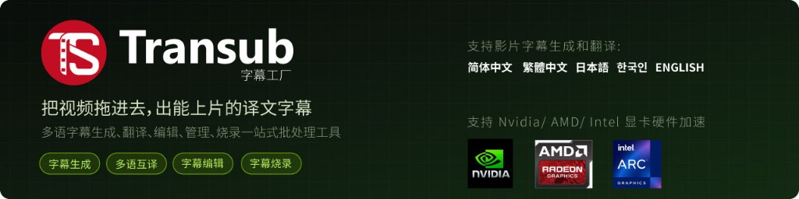
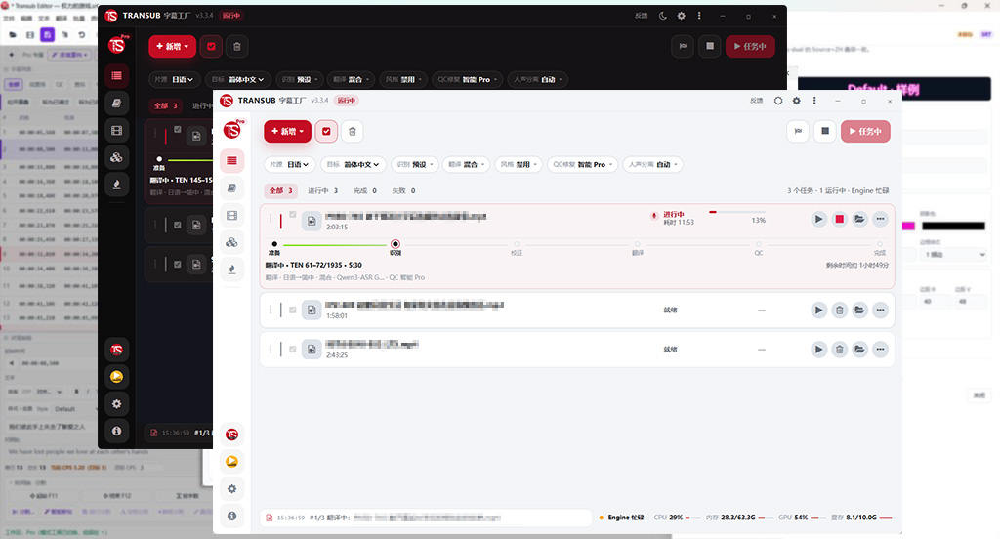

# Transub 字幕工厂

**本地优先的 Windows 字幕工作台**  
批量生成字幕 · 字幕多语翻译 · 精细编辑 · 字幕烧录 · 一键出片

[](https://github.com/dlsandy/Transub/releases) [](LICENSE) [](https://github.com/dlsandy/Transub/releases) [](https://afdian.com/item/41fef1a28bf211f189e252540025c377)

<p>
  
  
  
  
  
  
</p>

[功能亮点](#功能亮点) · [普通版 / Pro](#普通版--pro-对比) · [快速开始](#快速开始) · [下载](#下载) · [许可](#许可)

---

**把片子拖进去，智能化批量产出高质量字幕。**  
Transub 字幕工厂面向需要「听写 → 翻译 → 校对 → 导出 / 烧录」完整链路的追片族、创作者与字幕组：本地化批量完成字幕产出和质检修复，支持多样式字幕烧录成片。

普通版即可跑通完整流水线；追求高质量字幕、影视级人声切段、语境重构与智能质检时，再升级 **Pro**。

---

## 为什么选 Transub 字幕工厂

| 功能特色                      | 描述                                     |
| ------------------------- | -------------------------------------- |
| **本地运行**                  | ASR / 推理翻译可在本机 GPU 上跑，素材不必上传云端，隐私数据不泄露 |
| **工厂式批处理**                | 多文件排队、进度可见、自动质检和修复，任务完成后可自动打开编辑器或烧录    |
| **字幕管理器**                 | 转写、原文、译文字幕轻松掌控，历史记录有迹可循                |
| **内置Transub Editor字幕编辑器** | 专业级实时字幕编辑器，可视化编辑字幕内容                   |
| **模型/场景预设可换**             | 内置模型管理器，可根据场景选择合适的模型；「帮我选模型」一键应用推荐配方   |
| **多语言支持**                 | 支持英语、日语、韩语、中文（简/繁体）界面，且支持多语言字幕生成和翻译。   |
| **双语轨字幕**                 | 支持原文 / 译文双语轨字幕、合并行序；成片可直接进字幕库或烧录       |
| **深度优化日语识别和翻译**           | 针对日语进行深入优化，日剧、日漫追番轻松拿捏                 |



---

## 功能亮点

### 1. 批量字幕任务

拖入音视频或字幕文件，设定目标语与识别 / 翻译配方后即可开跑。支持双语输出、任务后动作（睡眠、关机等），适合整季连肝。

### 2. 专业字幕编辑器

结构化编辑 SRT / VTT / LRC（及 ASS 相关能力），音视频同步预览，时轴与波形辅助对齐，切分 / 合并工具齐全。

### 3. 质量检查与修复

CPS、流畅度、重叠等问题一目了然；可按规则批量修正。Pro 用户还可一键走 **智能修复**（局部重转写 / 润色 / 语义审阅）。

### 4. 字幕库 · 场景预设 · 模型管理

成品进字幕库统一管理；场景预设沉淀常用片源参数；模型管理集中下载 ASR / 翻译 / 决策辅助权重。

### 5. 字幕烧录

硬字幕烧录或软字幕封装。普通版内置「观影白字」「大字号观影」；Pro 解锁更多样式预设、文档 ASS 导出与硬件编码加速。

### 6. 本机翻译与外接 API

- **推理翻译**：Sakura / GalTransl 等专训模型，日→简中等场景开箱可用  
- **轻量 NMT**：引擎内 Opus 等多语 → 中路径  
- **外部翻译**：Transub Station 或 OpenAI 兼容 BYOK（普通版可用）  
- **忠实语气**：按语体约束译文风格（普通版可用）

---

## 普通版 / Pro 对比

普通版已经是完整可用的字幕工厂；Pro 解锁「更懂片」的进阶能力。

| 能力 | 普通版 | Pro |
|------|:------:|:---:|
| 批量 ASR 听写（多模型 / CUDA） | ✅ | ✅ |
| 推理翻译（Sakura / GalTransl 等） | ✅ | ✅ |
| 外部翻译（BYOK / Station） | ✅ | ✅ |
| 忠实语气 | ✅ | ✅ |
| 字幕编辑器 · 时轴 · 预览 | ✅ | ✅ |
| 规则 QC / 字幕库 / 场景预设 | ✅ | ✅ |
| 烧录：观影白字 / 大字号观影 | ✅ | ✅ |
| **混合翻译**（专训翻译 + 剧情贴合润色） | — | ✅ |
| **智能翻译**（对话模型按行） | — | ✅ |
| **影视音频增强**（人声分离 + 电影级 VAD） | — | ✅ |
| **语境 / 影片理解重构** | — | ✅ |
| **双语语义审阅** | — | ✅ |
| **QC 智能修复** | — | ✅ |
| **转录语义校正**（听写后、翻译前） | — | ✅ |
| **决策辅助**（Laya / System One 结构化门控） | — | ✅ |
| 烧录：更多样式 · 文档 ASS · 硬件编码 | — | ✅ |
| 软件内更大规格对话 / 润色模型 | 基础规格 | 全部规格 |

> Pro 许可为 **大版本内买断**（如 3.x 内 Pro 功能集；下一主版本需另行购买（按购买时间享不同的升级优惠））。

**[在爱发电查看 Pro →](https://afdian.com/a/transub)**

---

## 快速开始

1. 从 [Releases](https://github.com/dlsandy/Transub/releases) 下载 Windows 安装包 / 压缩包并安装
2. 首次启动按向导检查运行环境与基础配置
3. 在「模型管理」按需下载 ASR / 翻译权重（推荐先用「帮我选模型」）
4. 打开 **字幕任务**，拖入文件，选目标语与配方，开始批处理
5. 完成后可在 **字幕库** 查看，或进入编辑器精修、再走 **字幕烧录**
6. 详细使用指南请参看[Transub使用文档](https://www.transub.cc/docs/)

### 解锁 Pro（可选）

1. 在 [爱发电 · Transub](https://afdian.com/a/transub) 购买买断或 7 天体验包
2. 打开应用 **设置 → Pro**
3. 推荐：粘贴订单号 → **领取并激活**（本机绑定）
4. 亦可粘贴 `TSUB1.…` 密钥手动激活

许可同时绑定 **1 台设备**；换机冷却约 30 天；激活后需定期联网复核。

---

## 下载

| 渠道                                                             | 说明           |
| -------------------------------------------------------------- | ------------ |
| [GitHub Releases](https://github.com/dlsandy/Transub/releases) | 请认准官方下载渠道    |
| [爱发电](https://afdian.com/a/transub)                            | Pro 买断 / 体验包 |

系统要求概览：

- **系统**：Windows 10 / 11（x64）  
- **硬件**：独立显卡（NVIDIA CUDA）可显著加速听写与推理；无独显亦可 CPU 运行（更慢）  
- **磁盘**：模型按需下载，建议预留数 GB～数十 GB

---

## 适用场景

- 影视 / 动画 / Galgame 日语听写与中文字幕  
- 多语片源批量出简繁字幕  
- 字幕组校对：列表 + 时轴 + QC 闭环  
- 观影向硬字幕烧录或软字幕封装

---

## 开源与社区

- **Core（MIT）**：桌面壳、字幕编辑器、免费引擎路径、Pro 门控与验签（公钥）等  
- **Pro（专有）**：语境 / 影片重构、智能与混合翻译算法、影视音频增强管线、双语语义审阅等，随正式包 `_advanced` 模块分发

欢迎通过 [Issues](https://github.com/dlsandy/Transub/issues) 反馈问题与需求。

从源码运行（开发者）：

```bash
npm install
npm start
```

需要 Node.js ≥ 22.12。完整构建与打包请参阅仓库内开发说明。

---

## 许可

| 部分 | 许可 |
|------|------|
| 开源 Core | [MIT](LICENSE) |
| Pro 算法与 `_advanced` | [LICENSE-PRO](LICENSE-PRO)（需有效许可） |
| 说明 | [NOTICE](NOTICE) |

部分第三方模型权重（如 Sakura 系列）可能带有非商业条款，请遵循各模型卡片；条款约束权重本身，不改变本应用 Core 的 MIT 授权。

---

Transub · 字幕工厂 — 听得清，译得懂，改得快
