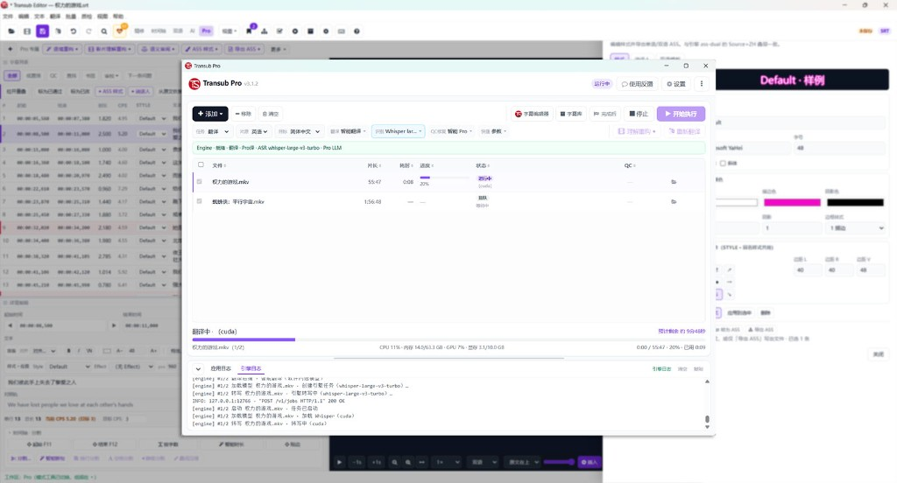
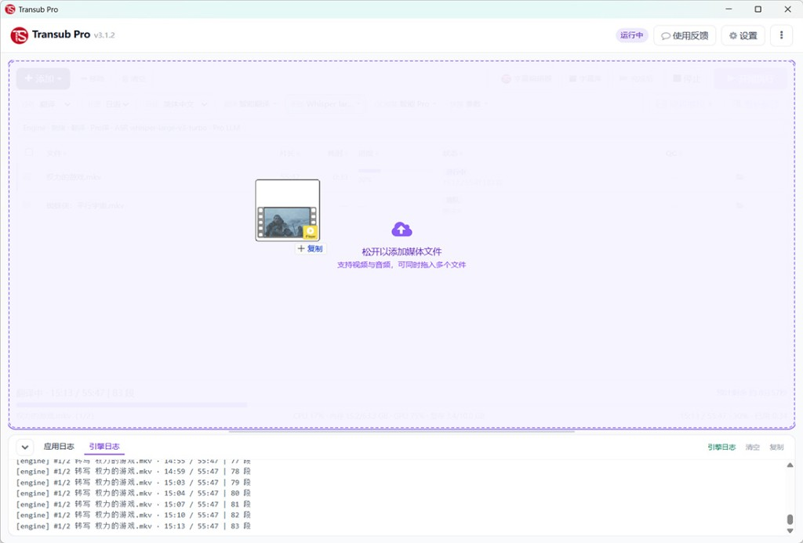
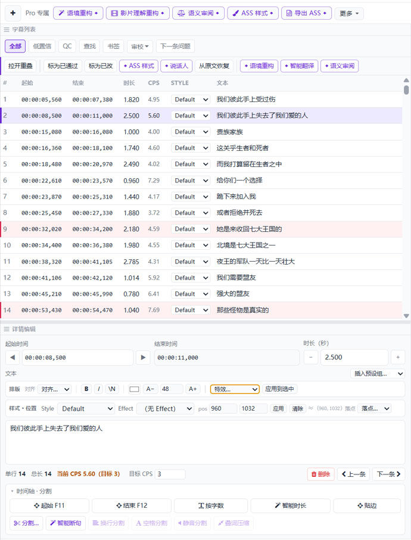
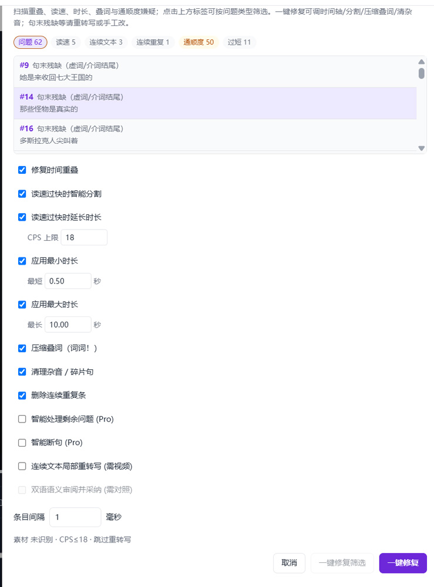
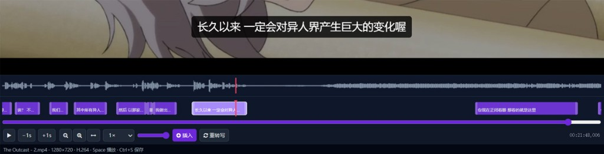
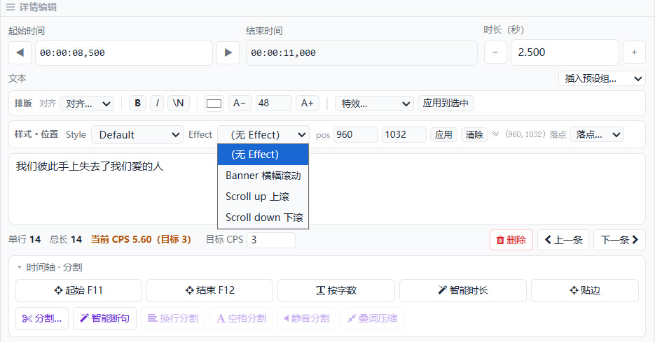
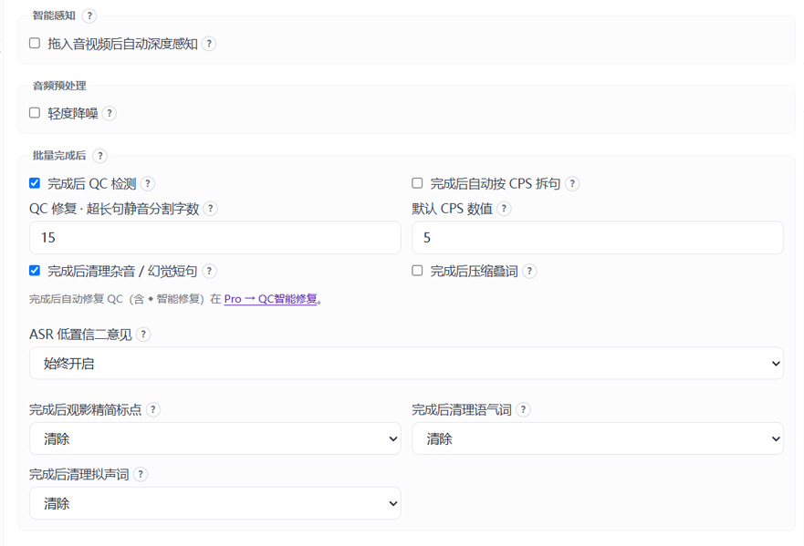
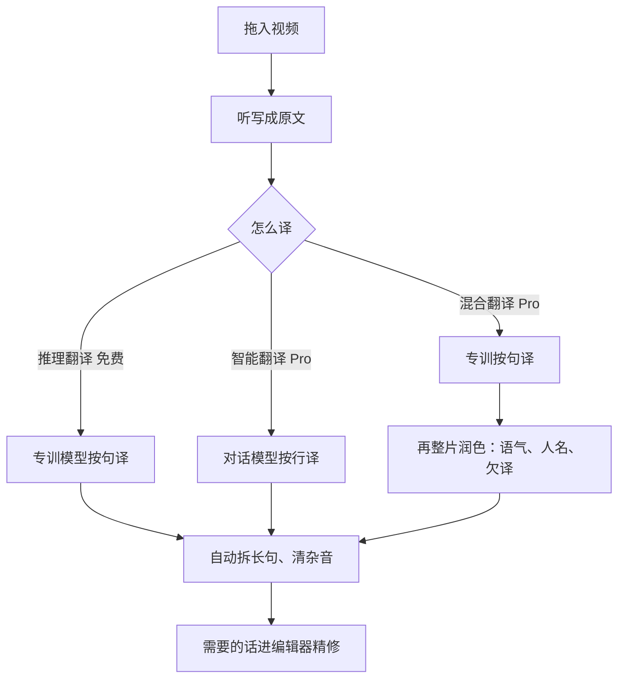

# Transub 字幕工厂

**把视频拖进去，出能上片的字幕。**  
本地运行 · NVIDIA / AMD GPU · 转写 / 翻译 / 双语 · SRT · VTT · ASS

[下载](https://github.com/dlsandy/Transub/releases) · [GitCode](https://gitcode.com/AndyDai/Transub/releases) · [变更记录](CHANGELOG.md) · [贡献指南](CONTRIBUTING.md) · [爱发电 / Pro](https://afdian.com/a/transub) · [问题反馈](https://github.com/dlsandy/Transub/issues)



---

## 目录

- [适合谁](#适合谁)
- [怎么用](#怎么用)
- [界面一览](#界面一览)
- [选哪种翻译](#选哪种翻译)
- [下载安装](#下载安装)
- [Pro 要不要买](#pro-要不要买)
- [从源码运行](#从源码运行)
- [许可](#许可)

---

## 适合谁

- 一整批视频要出字幕，不想一条条丢进网页
- 机翻初稿还不能用：句子太长、对白重叠、读起来太快、语气词一堆
- 日译中为主，也要处理英语 / 韩语 / 粤语等片源，或出简中、繁中、英、日、韩字幕
- 不确定怎么搭配识别与翻译模型：想用「组合方案」一键按片源、硬件选官方推荐
- 开跑后可以离开：任务结束可选睡眠 / 退出 / 关机；也可烧录软硬字幕后直接观影

免费就能走完：**听写 → 推理翻译 → 质检 → 编辑器精修**。Pro 是在这之上把语气、人名、人声分离和质检再推深一档，不是「不买就不能用」。

---

## 怎么用

1. [下载 zip](https://github.com/dlsandy/Transub/releases)，解压后打开 `transub.exe`
2. **第一次请走设置向导**（环境检查与修复、按电脑勾选并下载模型；体积较大，请留足时间和磁盘）
3. 不确定选哪个模型时，点主窗口翻译区左下角的 **组合方案 / 模型组合推荐**
4. 把文件或文件夹拖进主窗口，选 **原文 / 翻译 / 双语**，点开始
5. 跑完后列表会标出问题数；需要改的，点进 **字幕编辑器** 对着画面改

主窗口负责整批出稿；侧栏可进 **字幕库**、**字幕烧录**；编辑器负责一条条改到能上片（预览、波形、读速、一键修时间问题）。编辑器也可以单独打开。

界面可切简体 / 繁体 / English / 日本語 / 한국어。任务进行中能增删队列；中途停了可以断点继续。可用场景预设（含日语、粤语、歌曲等）管理识别参数。

---

## 界面一览

### 拖进去就开跑

支持视频与音频，可一次拖多个文件；进度、引擎日志和本机占用一目了然。侧栏 Dock 可在字幕任务、字幕库、烧录等视图间切换。



### 列表精修 + Pro 工具条

按低置信、质检、书签筛选；时间、读速（CPS）、样式一栏看清。Pro 可做语境重构、影片理解重构、语义审阅和 ASS 样式。



### 质量检查，一键修

扫描重叠、读速、时长、通顺度；勾选要修的项后一键修复。Pro 还可对残留问题做智能断句、局部重转写和语义审阅。



### 对着画面改时间轴

预览 + 波形 + 字幕块联动；可插入、局部重转写，空格播放、Ctrl+S 保存。



### 详情：时长、样式、智能分割

读速提示、智能时长、静音分割、叠词压缩；ASS 还可调特效与落点。



### 跑完自动收拾一遍

批次结束后可自动质检、清杂音 / 幻觉短句、精简标点与语气词；低置信句可开二意见。



---

## 选哪种翻译

任务选「翻译」或「双语」时，都从**同一份听写稿**出发，差别在目标字幕怎么译出来。只听写选 **原文** 即可，不生成译文。


|           | 推理翻译               | 智能翻译           | 混合翻译                  |
| --------- | ------------------ | -------------- | --------------------- |
| **费用**    | 免费                 | 需 Pro          | 需 Pro                 |
| **你得到什么** | 专训模型按句译，日译中主力      | 对话大模型按行译，偏语义还原 | 专训句级翻译 + 对话模型整片剧情贴合润色 |
| **适合**    | **大多数日译中**（推荐先试这个） | 想用通用大模型、多语成片   | 已经能用、还想更像人在说话         |


日译中优先用 **GalTransl 7B** 或 **Sakura 7B**（向导与组合方案会按硬件建议）。粤语书面语成片建议选 **Qwen** 或 **HY-MT2** 系列。

另外还有 **外部翻译**（填自己的 API Key，需 Pro）。不知道怎么搭配识别 / 翻译时，用主窗口的 **组合方案** 即可。

**实际会经历的步骤：**




一句话：**推理翻译负责把句子译准；混合翻译再让整集听起来是同一个人在说。**  
混合翻译的润色可以关（设置 → Pro → 智能翻译相关选项）。关掉之后，效果接近「只做句级专训翻译」。

非日语片源、或成片目标为英 / 日 / 韩时，混合翻译会改用多语专训或对话模型按行来译，质量取决于你选的模型。

---

## 下载安装


|     |                                                                       |
| --- | --------------------------------------------------------------------- |
| 系统  | **仅 Windows 10 / 11**                                                 |
| 安装  | 解压即用，没有安装程序                                                           |
| 依赖  | 识别、翻译、FFmpeg 都已带上，不必另装 Python                                         |
| GPU | NVIDIA（CUDA）与 AMD（ROCm）均可加速；部分 Whisper / CTranslate2 模型不支持 AMD，软件内会标注 |


1. 打开 [Releases](https://github.com/dlsandy/Transub/releases)（国内也可从 [GitCode](https://gitcode.com/AndyDai/Transub/releases)），下载 **zip**
2. 解压后运行 `transub.exe`（同目录有编辑器快捷方式）
3. 走完设置向导（环境修复 + 模型下载），再开始第一批任务
4. 以后用软件里的「检查更新」即可（国内网络优先 GitCode）；已经下载的模型会保留

> [!NOTE]
> 安装包目前没有代码签名。Windows 可能提示「未知发布者」，选仍要运行即可。可选把「用 Transub 生成字幕」加到右键菜单：`tools/register-context-menu.ps1`

卡住或报错：软件右上角 **使用反馈**，或开 [Issue](https://github.com/dlsandy/Transub/issues)。

---

## Pro 要不要买

多数人用免费的听写 + 推理翻译 + 编辑器就够。Pro 适合：已经在用，还想少改几遍稿。


| 买了之后        | 具体是什么                                           |
| ----------- | ----------------------------------------------- |
| 智能翻译        | 对话大模型按行译到成片目标语（可配剧情贴合润色 / 忠实复核）                 |
| 混合翻译        | 先专训句级译准，再整片把语气、人名、欠译调顺（可关润色；模型可本机或填自己的 API Key） |
| 影视音频增强      | 先用人声分离（Demucs）再听写，嘈杂片更稳；长片会按段切分以免内存爆掉           |
| 语境 / 影片理解重构 | 按场次用大模型改写，适合整段不像人话时                             |
| 双语语义审阅      | 查出漏译、错译，建议可一键采纳                                 |
| QC 智能修复     | 质检问题不只标红，还能断句、重转写、润色                            |
| 字幕烧录        | 软字幕 / 硬字幕烧入影片；Pro 可自定义样式与硬件编码                   |
| ASS 样式      | 转 ASS、说话人样式、特效、预览里拖位置                           |


购买：[爱发电](https://afdian.com/a/transub) → 软件里 **设置 → Pro** → 填订单号。  
买断覆盖当前大版本（例如 3.x）；出 4.0 需另购（有升级优惠）。开通后不退款。

本机跑大模型比较吃配置，大约 **内存 16 GB + 独立显卡 8 GB 显存** 更从容；也可以只用云端 API，不占本机显卡。Pro 细则见 [LICENSE-PRO](LICENSE-PRO) 与 [NOTICE](NOTICE)。

---

## 从源码运行

给要改程序的人。日常使用请直接 [下载发行包](https://github.com/dlsandy/Transub/releases)。

需要 **Node.js ≥ 22.12**。

```bash
git clone https://github.com/dlsandy/Transub.git
cd Transub
npm install
npm run setup:ffmpeg
# 将 Engine 独立版放到 transub-engine/（含 runtime\python.exe）
npm start
```

只开编辑器：`npm run start:editor`。打包：`npm run dist` 或 `build-win.bat`。

发版前：`npm run smoke:preflight`。变更记录：[CHANGELOG.md](CHANGELOG.md)。架构 / 引擎 / Agent 规则等开发文档仅保留在本机 `docs/` 与 `.cursor/rules/`（不随公开仓发布）。

---

## 许可

- 开源部分：[MIT](LICENSE)
- Pro 模块：[LICENSE-PRO](LICENSE-PRO) · [NOTICE](NOTICE)
- UI 图标：[Font Awesome 4.7](https://fontawesome.com/)（SIL OFL 1.1）

